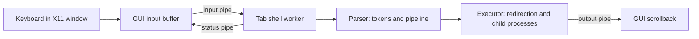

# Terminator: Task-by-Task Implementation Guide

This guide explains how the current Terminator code is organized, how each
assignment task is represented in the code, and what a reader should look for
when tracing a command from the window to a child process. It is written for a
reader who is new to this project and to the relevant C/POSIX calls.

The assignment describes a larger shell than the current program. To keep this
guide accurate, each task has a status and the guide calls out incomplete
requirements explicitly. A feature described as partial or not implemented
should not be presented as finished in a submission.

## Status overview

| Assignment area | Current status | What that means in this repository |
|---|---|---|
| Execution modes | Implemented | Thread mode is the default; `useProcess=True` selects one worker process per tab. |
| Task 1: X11 GUI and tabs | Implemented for the current terminal UI | The X11 window handles input, tabs, scrollback, and worker output. It is a small terminal interface, not a full terminal emulator. |
| Task 2: Built-in and external commands | Implemented | Required basic commands, external `fork()`/`execvp()`, and `$?` status are present. |
| Task 3: Multiline input and quoting | Mostly implemented | Common multiline, quoting, variable, `$()` and backtick cases are handled. This is a shell subset, not all Bash quoting and substitution behavior. |
| Task 4: I/O redirection | Implemented | `<`, `>`, `>>`, and redirection with pipeline commands are supported. |
| Task 5: Pipes | Implemented | Pipelines can contain multiple stages and can be combined with redirection. |
| Task 6: `multiWatch` | Implemented | Commands run concurrently, output is collected with `poll()`, and completed commands restart after about two seconds. |
| Task 7: Hotkeys | Partial | Editing and screen-control keys exist; persistent configurable bindings, command-history navigation, Ctrl+W, and X11 copy/paste are absent. |
| Task 8: Signals and job control | Core command job control implemented | `&`, `jobs`, `fg`, `bg`, Ctrl+C, and Ctrl+Z are implemented for child process groups. There is no PTY or full interactive terminal control. |
| Task 9: Searchable persistent history | Partial | Tabs share a synchronized in-memory ring of 1,024 commands. The 10,000-command history file and Ctrl+R search are absent. |
| Task 10: File-name completion | Not implemented | Tab does not scan the current directory or complete a filename. |
| Task 11: Bash script interpreter | Not implemented | `source` runs complete commands from a file; there is no custom interpreter for assignments, conditionals, positional parameters, or Bash script syntax. |

The source of truth for the remaining assignment work is the provided
[assignment PDF](../Terminator%20-%20Google%20Docs.pdf). The implementation
status above is based on the code in this repository, not on the intended
future design.

## 1. Project structure and design

The project uses a conventional C layout. The source tree stays small enough
that a new developer can follow a command path without navigating dozens of
one-function files.

```text
include/
  terminator.h       Shared application, tab, history, and worker types
  shell.h            Parser, pipeline, shell-state, and job interfaces
src/
  main.c             Startup, mode selection, shared history, shutdown
  gui.c              X11 window, input, drawing, tabs, and event polling
  tab.c              Per-tab pipes and worker thread/process lifecycle
  shell.c            Worker loop and built-in commands
  parser.c           Completeness checks, tokenizing, parsing, and expansion
  executor.c         Redirection, child processes, pipes, and job control
  multiwatch.c       Concurrent command supervisor for multiWatch
  history.c          Shared synchronized in-memory command history
 tests/              Worker tests and an X11 interaction driver
 docs/               Architecture, design, roadmap, and this guide
 Makefile            Build, clean, and test targets
 README.md           Short project overview and quick start
```

The design keeps three responsibilities separate:

1. `gui.c` owns the X11 display and the visible text buffers. It does not parse
   shell syntax or create each pipeline stage itself.
2. `shell.c` owns the state for one tab's worker, such as its logical current
   directory and last exit status. It receives complete input lines and asks
   the parser and executor to process them.
3. `parser.c` converts text into a structured pipeline. `executor.c` then
   performs the process and file-descriptor work described by that structure.

The main command path is:



A pipe is a one-way byte stream. Each tab has one pipe for commands going from
the GUI to the worker, one for output returning to the GUI, and one for small
completion/status messages. This keeps the GUI responsive while commands are
running and allows an inactive tab to continue working.

## 2. Execution modes used by every task

The PDF defines two ways to host each tab's shell worker. Both modes use the
same `worker_run`, parser, executor, and built-ins, so the command behavior is
shared.

### Thread mode

Running `./terminator` selects thread mode. The GUI and tab workers are threads
in the same process. Each tab gets its own `Tab` and `ShellContext`. The history
object is ordinary process memory, so all threads can access it. A POSIX
semaphore protects updates and snapshots.

### Process mode

Running `./terminator useProcess=True` selects process mode. `tab.c` forks a
worker process for each tab and the GUI keeps the pipe ends it uses. History
and the foreground-process-group value are mapped with `MAP_SHARED`, which
allows the parent and workers to see the same shared state. The history
semaphore is initialized as process-shared in this mode.

### Code path

- [src/main.c](../src/main.c): reads the optional mode argument and initializes
  history.
- [src/tab.c](../src/tab.c): `app_add_tab` assigns pipe ends and either starts a
  thread with `pthread_create()` or forks a worker process.
- [src/shell.c](../src/shell.c): `worker_run` reads commands in both modes.
- [src/history.c](../src/history.c): `history_init` selects the correct
  semaphore sharing mode.

The code keeps the GUI as the only part that calls Xlib. Child commands are
still created with `fork()` in both worker modes.

# Task 1:

### Implementation details:

The GUI is an Xlib window. It draws the tab bar, scrollback, current prompt,
editable input line, and cursor from the state stored in `App` and `Tab`.

Each tab owns a separate input buffer, multiline command buffer, scrollback
array, logical working directory, and communication pipes. Selecting another
tab changes which tab is drawn and receives keyboard input; it does not stop
the background worker for the tab that is hidden.

`XLookupString()` converts an X11 `KeyPress` event into text and a `KeySym`.
The GUI handles editing keys and sends a complete command to that tab's worker
when Enter is pressed. Output arrives through a pipe and is appended to the
same tab's scrollback.

The main event loop calls `poll()` on the X11 connection and the output/status
pipes for all tabs. `poll()` sleeps until something is ready, so the loop does
not continuously consume CPU while waiting.

This satisfies the assignment's basic window-based shell interface. It does
not provide a PTY, ANSI escape-sequence interpreter, terminal resize protocol,
or support for full-screen interactive programs. Those are separate terminal
emulator capabilities beyond this implementation.

### Where is the code for this:

- [src/gui.c](../src/gui.c): `gui_run`, `handle_key_press`,
  `draw_terminal_window`, `submit_input`, `append_output_text`.
- [src/tab.c](../src/tab.c): `app_add_tab`, `app_close_tab`, and the worker
  startup/cleanup paths.
- [include/terminator.h](../include/terminator.h): `App` and `Tab`, including
  each tab's input, scrollback, and pipe state.

### Explanation of that particular code snippet used

The window loop uses this pattern (shortened to show the important decision):

```c
int pr = poll(pf, nf, -1);
if (pr < 0) {
  if (errno == EINTR)
    continue;
  break;
}
```

`pf` lists the X11 connection and the pipes that can produce output or a
status update. A timeout of `-1` means “wait until one becomes ready.” If a
signal interrupts the wait, the loop retries. When an X11 event is ready,
`gui_run` reads events with `XNextEvent()` and calls the appropriate handler.
When an output pipe is ready, it reads bytes and appends them to that tab's
scrollback. The window is then redrawn from the saved buffers.

The tab creation code establishes the GUI/worker directions explicitly:

```c
/* input: GUI writes, worker reads */
tab->input_fd = input_pipe[1];
tab->worker_input_fd = input_pipe[0];

/* output: worker writes, GUI reads */
tab->output_fd = output_pipe[0];
tab->worker_output_fd = output_pipe[1];
```

For a POSIX pipe, array element `0` is the read end and element `1` is the
write end. Naming the fields from each side's point of view makes the direction
clear. The process-mode branch closes the ends each process does not use; this
is important because an unused open write end can prevent the reader from
seeing end-of-file.

## Task 2:

### Implementation details:

The shell has built-ins for commands that need access to a tab's shell state:
`cd`, `exit`, `history`, `multiWatch`, `jobs`, `fg`, `bg`, `clear`, and `source`.
The built-in table in `shell.c` maps a command name to its handler. `cd` updates
the tab's logical directory in `ShellContext`; this does not call `chdir()` in
the GUI process and therefore does not change another tab's directory.

External commands are launched by the executor in child processes. The child
changes to the tab's logical directory, applies redirections, checks whether
the command is a built-in that can run in that child, and otherwise calls
`execvp()`. If the command cannot be found, an error is printed to the tab and
the worker remains available for later commands.

The result of the last executed command is stored in `ShellContext.last_status`.
The parser expands `$?` using that value. A failed external command returns a
nonzero value, so a later `echo $?` can display the previous result.

The `source` built-in is a basic command-file runner. It accumulates lines until
a command is complete, then calls `shell_run_line`. It is not the custom Bash
script interpreter required by Task 11; that distinction is described there.

### Where is the code for this:

- [src/shell.c](../src/shell.c): built-in handlers, the built-in lookup table,
  and `worker_run`.
- [src/executor.c](../src/executor.c): `run_command_in_child`,
  `shell_execute`, and external command launch.
- [src/parser.c](../src/parser.c): `$?` expansion in `shell_expand_word`.
- [include/shell.h](../include/shell.h): `ShellContext` and built-in function
  interfaces.

### Explanation of that particular code snippet used

External execution ends with this sequence in `run_command_in_child`:

```c
execvp(command->arguments[0], command->arguments);
int err = errno;
if (err == ENOENT)
  dprintf(STDERR_FILENO, "terminator: %s: command not found\n",
          command->arguments[0]);
return 127;
```

`execvp()` searches the command path and replaces the child process with the
requested program. It only returns when it fails. The code saves `errno` before
printing because later library calls can change it. Returning status `127` is
the usual shell convention for “command not found.” The parent worker waits for
the child and returns to its input loop, so an unknown command does not destroy
the tab.

A built-in needs the worker's state, so `shell_execute` handles state-changing
single commands before it creates an external child. This is why `cd` can
change the correct tab and why `exit` can stop that tab's worker.

## Task 3:

### Implementation details:

The GUI keeps collecting input when `shell_is_complete()` sees an unfinished
quote, trailing escape, open backtick command, or open `$()` substitution. It
shows a continuation prompt and appends the next input line to the same
multiline buffer. A trailing backslash joins the next line without retaining
the backslash; other multiline forms retain a newline.

The lexer separates shell operators (`|`, `<`, `>`, `>>`, and `&`) only when
they are outside quotes and command substitutions. The parser then builds
`SimpleCommand` records. Word expansion removes quote characters, preserves
single-quoted text literally, and expands variables and command substitutions
where the current shell subset allows them. `$()` is evaluated through a
capturing pipe; backtick substitution is also recognized.

The implementation supports the common forms required for Tasks 1–5 and
includes nested `$()` handling. It is deliberately not a full Bash parser. In
particular, nested legacy backtick quoting and the full Bash expansion/escaping
rules are not promised by this code.

### Where is the code for this:

- [src/gui.c](../src/gui.c): `submit_input` decides whether Enter submits a
  command or keeps collecting multiline text.
- [src/parser.c](../src/parser.c): `shell_is_complete`, `shell_lex`,
  `shell_parse`, `shell_expand_word`, and `capture_command_output`.
- [include/shell.h](../include/shell.h): `Tokens`, `SimpleCommand`, and
  `Pipeline` data structures.

### Explanation of that particular code snippet used

The completeness check tracks syntax that can span lines. This is an excerpt
from the scanner; its escape and quote-state branches are shown together to
make the tracked state easier to see:

```c
if (*s == '\\' && quote != '\'')
  escaped = 1;
else if (*s == '\'' || *s == '"')
  quote = *s;
else if (*s == '$' && s[1] == '(') {
  depth++;
  ++s;
} else if (*s == ')' && depth)
  depth--;
```

This is a state machine: `quote` remembers whether the scan is inside a
single- or double-quoted string; `escaped` means the next character is
protected by a backslash; and `depth` counts nested `$(` pairs.
At the end of the input, any still-open state means the GUI should show `>` and
wait for more text. The actual code also tracks backticks.

The lexer uses the same idea for token boundaries. A pipe inside a quoted word
is regular text; a pipe outside a quote ends the current token and connects
pipeline stages. This keeps parsing separate from process creation.

## Task 4:

### Implementation details:

The parser recognizes `<`, `>`, and `>>` and stores their following filenames
in `SimpleCommand.input_path` and `SimpleCommand.output_path`. The executor
opens the files and uses `dup2()` to make the opened file the child's standard
input or standard output. When an input file cannot be opened, the child
returns an error before `execvp()` runs.

Input and output redirection can be present on the same command. Redirection
also works on an individual pipeline stage. Each child opens its own file
handles, so separate background jobs do not share one mutable input offset.

### Where is the code for this:

- [src/parser.c](../src/parser.c): `shell_parse` recognizes redirection
  operators and stores filenames.
- [src/executor.c](../src/executor.c): `redirection_open_input`,
  `redirection_open_output`, `redirection_apply`, and the child launch path.
- [include/shell.h](../include/shell.h): `SimpleCommand` redirection fields.

### Explanation of that particular code snippet used

The executor redirects standard input this way:

```c
int fd = redirection_open_input(command->input_path, error_fd);
if (fd < 0)
  return -1;
if (dup2(fd, STDIN_FILENO) < 0) {
  close(fd);
  return -1;
}
close(fd);
```

`open()` creates a descriptor for the input file. `dup2(fd, STDIN_FILENO)`
replaces descriptor `0` (standard input) with a copy of that file descriptor.
The original descriptor is then closed because standard input now refers to the
file. If `open()` fails, the function returns an error and the command is not
started. The output path follows the same pattern with `STDOUT_FILENO` and
`O_TRUNC` or `O_APPEND` for `>` and `>>`.

## Task 5:

### Implementation details:

A parsed pipeline is an array of `SimpleCommand` stages. For `N` stages,
`execute_pipeline()` creates `N - 1` pipes and forks one child per stage. A
middle stage reads from the previous pipe and writes to the next pipe. The
first stage inherits the worker's input policy and the final stage writes to
the GUI output pipe. Each child closes every pipe end it does not need.

All children in a pipeline are placed in one process group. This lets the
worker wait for the full foreground pipeline and lets Ctrl+C/Ctrl+Z signal the
whole pipeline together. Redirection is applied within each stage after the
pipeline descriptors are connected, so file redirection can override a stage's
standard input or output as expected for the supported shell subset.

### Where is the code for this:

- [src/parser.c](../src/parser.c): `shell_parse` splits a line at unquoted `|`
  tokens and creates the `Pipeline` array.
- [src/executor.c](../src/executor.c): `execute_pipeline` allocates pipes,
  forks stages, wires file descriptors, and waits or records a background job.
- [include/shell.h](../include/shell.h): `Pipeline` and `SimpleCommand`.

### Explanation of that particular code snippet used

The allocation follows the pipeline rule directly:

```c
size_t count = pipeline->count;
int (*pipes)[2] = count > 1 ? calloc(count - 1, sizeof(*pipes)) : NULL;
for (size_t i = 0; i + 1 < count; ++i)
  pipe(pipes[i]);
```

For one command, no pipe is needed. For two commands, one pipe connects them.
For three commands, two pipes connect stage 1 to stage 2 and stage 2 to stage 3.
The loop uses `i + 1 < count`, which creates exactly one fewer
pipe than there are commands. In each forked child, `dup2()` connects the
appropriate read end to standard input and the appropriate write end to
standard output. Closing unused ends is essential: if a process accidentally
keeps a pipe's write end open, the next command may wait forever for EOF.

## Task 6:

### Implementation details:

`multiWatch` accepts a list of command strings. It starts one process per
command and gives each process its own output pipe. A supervisor polls all of
the read ends, forwards output as it arrives, and restarts a command about two
seconds after that command exits. The supervisor and its command children use a
process group so Ctrl+C can stop the watched work while leaving the tab's shell
worker alive.

Each start prints the command and a Unix timestamp followed by the separator
line required by the assignment. A separator is also printed when a run ends.
The supervisor uses `poll()` instead of a busy loop.

### Where is the code for this:

- [src/multiwatch.c](../src/multiwatch.c): `shell_builtin_multiwatch`,
  `start_watched_command`, and `run_watch_supervisor`.
- [src/gui.c](../src/gui.c): Ctrl+C handling sends a signal to the active
  foreground process group.
- [src/executor.c](../src/executor.c): process-group tracking shared with
  ordinary foreground commands.

### Explanation of that particular code snippet used

The supervisor constructs a poll entry for each active command:

```c
poll_fds[poll_count] =
    (struct pollfd){commands[i].output_fd, POLLIN | POLLHUP, 0};
indexes[poll_count++] = i;
```

`poll_fds` tells `poll()` which descriptor to watch. `POLLIN` means output is
available; `POLLHUP` means the writer has closed its end. `indexes` remembers
which command belongs to each poll entry because the compact poll array only
contains commands with an open output pipe. After `poll()` returns, the
supervisor reads the ready descriptor and writes those bytes to the shell
worker's output descriptor.

## Task 7:

### Implementation details:

Some editing shortcuts are handled directly in `handle_key_press`: left/right
move the cursor, Home/End and Ctrl+A/Ctrl+E move to line boundaries, Backspace
deletes before the cursor, Ctrl+U/Ctrl+K delete part of the line, Ctrl+L clears
scrollback, and Ctrl+D closes an empty tab. Up/Down currently scroll the
visible output rather than browse command history.

The assignment also requires user-configurable bindings that persist across
restarts, command-history navigation, Ctrl+W, and Ctrl+Shift+C/Ctrl+Shift+V
using X11 selections. Those are not implemented. The current shortcuts are
hard-coded in `gui.c`.

### Where is the code for this:

- [src/gui.c](../src/gui.c): `handle_key_press`, `insert_input_text`,
  `submit_input`, and `clear_scrollback`.
- [include/terminator.h](../include/terminator.h): input buffer and cursor
  fields in `Tab`.
- [src/history.c](../src/history.c): shared history storage, but it is not yet
  connected to Up/Down or Ctrl+R search.

### Explanation of that particular code snippet used

Cursor insertion is based on moving the text after the cursor to make room:

```c
memmove(tab->input + tab->cursor + n,
        tab->input + tab->cursor,
        tab->input_len - tab->cursor);
memcpy(tab->input + tab->cursor, text, n);
tab->cursor += n;
tab->input_len += n;
tab->input[tab->input_len] = 0;
```

`memmove()` is used because the source and destination ranges are inside the
same input array and can overlap. The first call shifts the right-hand part of
the line forward. The second copies the newly typed characters into the gap.
Finally, the cursor and input length are increased. The actual helper also
checks that the line will still fit in the fixed-size buffer.

This is the editing foundation for adding the missing hotkeys, but the current
code does not yet load a key-binding file or persist user changes.

## Task 8:

### Implementation details:

The parser recognizes a trailing `&` and marks the pipeline as a background
job. The executor creates a process group for each pipeline and stores
background jobs in the tab's `ShellContext.jobs` table. The built-ins `jobs`,
`fg`, and `bg` list, foreground, and resume those groups.

The GUI handles Ctrl+C and Ctrl+Z as X11 key events. It reads the foreground
process-group ID from shared state and sends SIGINT or SIGTSTP to the negative
process-group ID, which signals every process in that group. The shell worker
remains outside the child's process group and can print the prompt again after
the foreground command stops or exits.

This implements the assignment's basic process job control. Because this
project does not allocate a PTY or transfer terminal ownership, programs that
need a real interactive terminal (for example, a full-screen editor) are not
supported.

### Where is the code for this:

- [src/parser.c](../src/parser.c): parsing of trailing `&`.
- [src/executor.c](../src/executor.c): `record_job`,
  `wait_for_process_group`, `execute_pipeline`, `shell_jobs_list`,
  `shell_job_foreground`, and `shell_job_background`.
- [src/gui.c](../src/gui.c): Ctrl+C/Ctrl+Z key handling.
- [include/shell.h](../include/shell.h): `ShellJob`, `JobState`, and the
  per-worker job table.

### Explanation of that particular code snippet used

The GUI sends a signal to the entire current foreground process group:

```c
int process_group = atomic_load(&tab->foreground->pgid);
if (process_group > 0)
  (void)kill(-process_group, SIGINT);
```

The minus sign is meaningful: on POSIX systems, a negative process ID passed
to `kill()` targets a process group. The shared atomic value lets the GUI read
the current foreground group safely in both thread and process modes. The
worker updates it when launching a foreground pipeline and clears it when the
pipeline exits or stops.

## Task 9:

### Implementation details:

All tabs use one `SharedHistory` object. In thread mode it is shared process
memory. In process mode it is placed in `MAP_SHARED` memory. `history.c`
implements a fixed-size ring buffer: new commands overwrite the oldest entry
once the ring is full. An unnamed POSIX semaphore protects both insertion and
snapshot copying, so one tab cannot read a partially written history entry
while another tab is adding a command.

The current capacity is 1,024 commands. The `history` built-in displays the
available in-memory entries. The assignment's 10,000-command history file,
startup reload, and Ctrl+R matching behavior are not implemented. History is
shared between tabs for the lifetime of the application, but it is not
persistent across restarts.

### Where is the code for this:

- [src/history.c](../src/history.c): `history_init`, `history_add`,
  `history_snapshot`, and `lock_history`.
- [src/shell.c](../src/shell.c): `builtin_history` and the call to
  `history_add` in `worker_run`.
- [src/main.c](../src/main.c): allocates history differently for thread and
  process modes.
- [include/terminator.h](../include/terminator.h): `SharedHistory` and
  `TERM_HISTORY_CAP`.

### Explanation of that particular code snippet used

Adding a command chooses the next ring slot and advances the write position:

```c
size_t entry_offset = history->next++ % TERM_HISTORY_CAP;
strncpy(history->entries[entry_offset], line, TERM_LINE_MAX - 1);
if (history->count < TERM_HISTORY_CAP)
  history->count++;
```

The modulo operation wraps the slot index to the start of the array when it
reaches the end. `count` records how many slots contain valid entries so far.
The semaphore is acquired before this snippet and released after it. A history
snapshot also holds the semaphore while copying entries into the caller's
buffer, then returns the entries in oldest-to-newest order. This gives the
`history` built-in a stable view of shared memory.

## Task 10:

### Implementation details:

Filename completion is not implemented. Pressing Tab does not scan the active
tab's working directory, extend a prefix, show ambiguous matches, or insert a
selected match. The current key handler has no filename-completion branch.

The natural integration point is the existing input buffer and cursor in
`Tab`, together with `tab->cwd`. A completion routine would inspect the word
immediately before the cursor, list matching entries in that tab's directory,
replace only that word, and leave the rest of the line unchanged. Ambiguous
matches would require a small selection state in the GUI. These are design
notes only; no placeholder implementation or empty module has been added.

### Where is the code for this:

- [src/gui.c](../src/gui.c): `handle_key_press` and `insert_input_text` are the
  input integration points; there is currently no completion function.
- [include/terminator.h](../include/terminator.h): `Tab.input`, `Tab.cursor`,
  and `Tab.cwd` provide the current line, insertion point, and directory.

### Explanation of that particular code snippet used

The current input helper inserts literal text at the cursor:

```c
memmove(tab->input + tab->cursor + n,
        tab->input + tab->cursor,
        tab->input_len - tab->cursor);
memcpy(tab->input + tab->cursor, text, n);
tab->cursor += n;
tab->input_len += n;
tab->input[tab->input_len] = 0;
```

This helper knows how to edit the line, but it does not know how to find file
names. A completion implementation would first identify the prefix before the
cursor, find matching directory entries using `tab->cwd`, then call the same
style of buffer update with the completed text. Because no directory scan or
ambiguous-selection logic exists now, this task must be considered unfinished.

## Task 11:

### Implementation details:

A custom Bash-subset interpreter is not implemented. The `source` built-in
opens a file, gathers lines until the existing command-completeness check says
they form one command, and sends that text through the normal shell parser and
executor. This is enough to run simple command files with the shell features
already supported by the program.

It does not parse shell variable assignments, positional arguments such as
`$1` or `$#`, `if`/`elif`/`else`/`fi` blocks, `[ ... ]` tests, or script-level
syntax errors such as a missing `fi`. Also, `./script.sh` and `bash script.sh`
are ordinary external commands in this implementation; the project does not
intercept them and interpret the script itself. Therefore Task 11 remains
unfinished even though a basic `source` built-in exists.

### Where is the code for this:

- [src/shell.c](../src/shell.c): `builtin_source` and `worker_run`.
- [src/parser.c](../src/parser.c): current single-command parser; it does not
  contain a script grammar or conditional-block parser.
- [src/executor.c](../src/executor.c): external command execution through
  `execvp()`.

### Explanation of that particular code snippet used

For each complete command read from a source file, the current code does this:

```c
command_status = shell_run_line(shell, command, output_fd);
command_length = 0;
command[0] = 0;
```

`builtin_source` accumulates text in `command`. Once it is complete, it passes
the entire text to the same `shell_run_line()` path that handles an interactive
command, then clears the buffer for the next command. There is no separate
script execution state, no variable assignment table, and no `if` block parser.
That is why `source` should be described as basic command-file execution, not
as the Task 11 interpreter.

## 3. How to trace a command through the program

Use this sequence when reading the code or stepping through it in a debugger:

1. `gui_run()` receives an X11 event and `handle_key_press()` edits the active
   tab's input buffer.
2. `submit_input()` appends the current line to the tab's multiline buffer. If
   syntax is incomplete, it leaves the command in the GUI and draws the
   continuation prompt. If complete, it writes the command to the tab's input
   pipe.
3. `worker_run()` reads bytes until a newline, checks completeness again,
   records the command in shared history, and calls `shell_run_line()`.
4. `shell_run_line()` calls `shell_parse()` to produce a `Pipeline`, expands
   every command argument, and then calls `shell_execute()`.
5. `shell_execute()` runs state-changing built-ins in the worker or calls
   `execute_pipeline()` for external commands and pipeline stages.
6. The child processes write to the worker's output pipe. `gui_run()` notices
   the readable pipe, appends output to the correct tab, reads the completion
   status pipe, and redraws the window.

This sequence also explains why `ShellContext` is per worker: it holds the
logical directory, `$?`, and job table that should belong to one tab. `App`
contains the GUI-wide state and the array of tabs. `SharedHistory` is the
intentional shared state used by all tabs.

## 4. Build and verification

The [Makefile](../Makefile) compiles the eight C source modules into
`./terminator`. `make clean` removes the generated `build/` directory and
binary. `make test` runs the worker checks in thread and process modes and then
runs the GUI interaction checks under Xvfb.

The repository's tests cover the implemented worker behavior, including
parsing, command execution, shared in-memory history, redirection, pipelines,
job control, `multiWatch`, and GUI tab interaction. A passing test run does not
mean the missing requirements in Tasks 7, 9, 10, and 11 have been implemented;
the tests exercise the functionality that currently exists.

Useful commands from the project root:

```sh
make                 # build ./terminator
./terminator         # launch with thread workers
./terminator useProcess=True  # launch with process workers
make test            # run worker and GUI checks
make clean           # remove generated build products
```

See also [README.md](../README.md) for the short quick start,
[architecture.md](architecture.md) for module boundaries,
[design.md](design.md) for implementation choices, and [roadmap.md](roadmap.md)
for future integration points.
