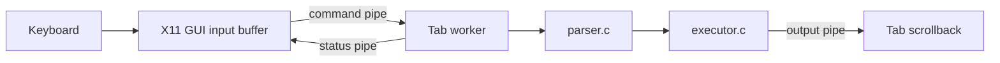

# Architecture

Terminator uses a small, conventional C layout. The current modules each have
one main responsibility; related helpers stay together in their source file.

```text
include/
  terminator.h   Application, tab, history, and worker data structures
  shell.h        Parser, command, shell-state, and job structures
  scrollback.h   Per-tab scrollback buffer and scrolling interface
  selection.h    Text selection and clipboard interface
  hotkeys.h      Configurable key-binding interface
  completion.h   Filename completion interface
src/
  main.c         Startup, mode selection, history setup, and shutdown
  gui.c          X11 window, keyboard input, drawing, and event loop
  selection.c    Mouse text selection and X11 clipboard handling
  tab.c          Per-tab pipes and worker thread/process lifecycle
  shell.c        Shell worker, built-ins, and command-file execution
  parser.c       Input completeness, tokenizing, parsing, and expansion
  executor.c     Redirection, pipelines, child processes, and jobs
  multiwatch.c   Concurrent command supervisor for multiWatch
  history.c      Persistent shared command history and search
  scrollback.c   Bounded per-tab output history and viewport tracking
  hotkeys.c      Default hotkeys and ~/.terminatorrc loading
  completion.c   Current-directory filename matching and input insertion
docs/            Task guide, architecture, design, and roadmap
```

## Command flow



1. `gui.c` receives keyboard events, keeps the editable line, and sends a
   complete command to the selected tab.
2. `tab.c` connects the GUI and worker with three pipes: one for commands, one
   for command output, and one for command status and the tab's working
   directory.
3. `shell.c` reads commands, keeps the state for that tab, and implements
   built-ins such as `cd`, `history`, and `less`.
4. `parser.c` turns the input into a `Pipeline` containing one or more
   `SimpleCommand` values.
5. `executor.c` applies redirection, creates pipeline processes, and waits for
   foreground jobs. Output returns through the tab's output pipe.

The GUI polls the X11 connection and every tab's output and status pipes. It
sleeps while there is no input or output to process. Only the GUI calls Xlib.
Mouse selection and clipboard messages are handled in `selection.c` by the
same GUI thread. Selection uses the rendered text for visible output, the live
prompt, and the editable input line.
Each tab owns its own scrollback ring, limited to 10,000 lines and 1 MiB of
allocated line text. The GUI draws the active tab's visible slice and tracks
its first visible line while output continues. For a line larger than the
budget, the buffer keeps its tail and evicts older lines as needed.
The mouse wheel and Page Up/Page Down move that view; reaching the bottom turns
follow-output back on.

## Execution modes

The command behavior is the same in both modes. The difference is how each
tab's shell worker is started:

- **Thread mode** is the default. `tab.c` starts one POSIX thread per tab. The
  threads share the process's history object.
- **Process mode** is selected with `./terminator useProcess=True`. `tab.c`
  forks one worker process per tab. Workers share a small history-coordination
  structure in memory and read/write the same persistent history file.

In either mode, a worker owns a `ShellContext`. It contains the tab's logical
working directory, last command status, and job table. A `cd` changes this
context rather than the GUI process's current directory, so tabs keep separate
working directories.

## Shared history, search, completion, and signals

`history.c` stores commands in `~/.terminator_history` by default. Set
`TERMINATOR_HISTORY_FILE` to use another path. A semaphore protects threads
inside one application, and a sidecar lock file coordinates separate
Terminator processes. The file keeps the newest 10,000 commands; the `history`
built-in prints the newest 1,000. Ctrl+R first shows every command containing
the typed, case-sensitive text. If none do, it shows commands tied for the
longest shared continuous substring when that substring is more than two bytes.
The current code follows the assignment example by showing all containing
commands, rather than only the newest whole-command match.

`completion.c` finds the word before the active tab's cursor and scans the
active tab's logical working directory, or a directory path typed as part of
the word. One match is inserted. Multiple matches insert their common prefix
and display a sorted numbered list if they remain ambiguous. The GUI keeps
text after the cursor in place and lets the user select a candidate by number.

The `less` built-in copies files or standard input to its output stream, which
the GUI adds to that tab's scrollback. It is a simple viewer because the
application does not have a PTY for full-screen pager controls.

`include/terminator.h` defines `SharedHistory` as the lock, history-file path,
and cached file metadata. Command records live on disk; the small coordination
structure is shared with workers in process mode.

Each tab also has a shared foreground process-group ID. The GUI uses it to send
Ctrl+C or Ctrl+Z to the active tab's foreground job. The worker remains alive
to accept the next command. Background jobs are tracked by that tab's
`ShellContext`, so `jobs`, `fg`, and `bg` affect only that tab.

## Design boundary

This is a shell window with command output, not a complete terminal emulator.
It does not allocate a PTY or interpret the full terminal control protocol.
The parser handles the shell syntax implemented for this project; it does not
implement all of Bash. See [design.md](design.md) for details and
[roadmap.md](roadmap.md) for remaining assignment tasks.
