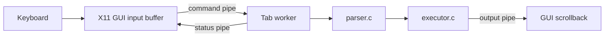

# Architecture

Terminator uses a small, conventional C layout. The current modules each have
one main responsibility; related helpers stay together in their source file.

```text
include/
  terminator.h   Application, tab, history, and worker data structures
  shell.h        Parser, command, shell-state, and job structures
src/
  main.c         Startup, mode selection, shared history, and shutdown
  gui.c          X11 window, keyboard input, drawing, and event loop
  tab.c          Per-tab pipes and worker thread/process lifecycle
  shell.c        Shell worker, built-ins, and command-file execution
  parser.c       Input completeness, tokenizing, parsing, and expansion
  executor.c     Redirection, pipelines, child processes, and jobs
  multiwatch.c   Concurrent command supervisor for multiWatch
  history.c      Shared in-memory command history
tests/           Worker checks and X11 interaction driver
docs/            Task guide, architecture, design, and roadmap
```

## Command flow



1. `gui.c` receives keyboard events, keeps the editable line, and sends a
   complete command to the selected tab.
2. `tab.c` connects the GUI and worker with three pipes: one for commands, one
   for command output, and one for command status and the tab's working
   directory.
3. `shell.c` reads commands and keeps the state for that tab.
4. `parser.c` turns the input into a `Pipeline` containing one or more
   `SimpleCommand` values.
5. `executor.c` applies redirection, creates pipeline processes, and waits for
   foreground jobs. Output returns through the tab's output pipe.

The GUI polls the X11 connection and every tab's output and status pipes. It
sleeps while there is no input or output to process. Only the GUI calls Xlib.

## Execution modes

The command behavior is the same in both modes. The difference is how each
tab's shell worker is started:

- **Thread mode** is the default. `tab.c` starts one POSIX thread per tab. The
  threads share the process's history object.
- **Process mode** is selected with `./terminator useProcess=True`. `tab.c`
  forks one worker process per tab. History is stored in shared memory so the
  workers and GUI can access the same ring.

In either mode, a worker owns a `ShellContext`. It contains the tab's logical
working directory, last command status, and job table. A `cd` changes this
context rather than the GUI process's current directory, so tabs keep separate
working directories.

## Shared history and signals

`history.c` stores up to 1,024 commands in a ring. One unnamed POSIX semaphore
protects both updates and snapshots. It is initialized for threads in thread
mode and as process-shared in process mode.

Each tab also has a shared foreground process-group ID. The GUI uses it to send
Ctrl+C or Ctrl+Z to the active tab's foreground job. The worker remains alive
to accept the next command. Background jobs are tracked by that tab's
`ShellContext`, so `jobs`, `fg`, and `bg` affect only that tab.

## Design boundary

This is a shell window with command output, not a complete terminal emulator.
It does not allocate a PTY or interpret the full terminal control protocol.
The parser handles the shell syntax implemented for this project; it does not
implement all of Bash. See [design.md](design.md) for details and
[roadmap.md](roadmap.md) for remaining assignment tasks.
